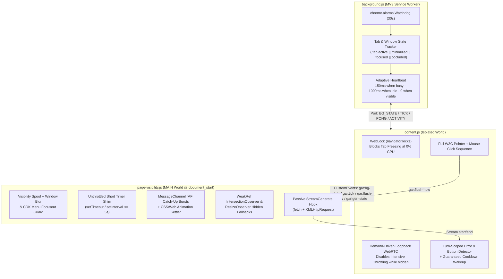

# Background Tab Auto-Retry: The Problem & How v2.0.0 Solves It

Running reliable UI automation inside a backgrounded, minimized, or occluded Google Gemini (`gemini.google.com`) tab in modern Chrome is surprisingly difficult. A naive content script that simply watches the DOM with `MutationObserver` and calls `button.click()` works fine while you are looking at the tab—and then silently stalls, misses retries, or hangs indefinitely the moment you switch tabs.

This document explains **why** Chromium and Gemini's Angular/Wiz frontend stall in background tabs, why `chrome.debugger` worked as a brute-force workaround in v1.5.0, and how **v2.0.0** achieves the same reliability **without** the `debugger` permission, warning banner, or DevTools conflicts.

---

## 1. The Problem: Why Background Gemini Tabs Hang or Fail to Retry

When a tab becomes hidden (switched to another tab, minimized, or covered by another window under macOS/Windows native window occlusion), **six separate bottlenecks** compound across Chromium's C++ engine, Manifest V3, and Gemini's frontend:

### 1.1 Chromium's *Quick Intensive Wake Up Throttling* (`setTimeout` capped at 1 wake-up / minute)
Within ~10 seconds of a loaded tab becoming hidden, Chromium's `PageSchedulerImpl` applies **Intensive Wake Up Throttling**: JavaScript timers (`setTimeout` and `setInterval`) are throttled to fire **at most once every 60 seconds**.

Gemini's Angular + RxJS frontend relies heavily on short `setTimeout` macrotasks (`0ms–250ms`) for:
- Streaming token reveal queues and RxJS scheduling (`timer`, `delay`, `auditTime`, `debounceTime`),
- Angular change detection / macrotask yields,
- Mounting and positioning Angular CDK overlays (such as the **Redo → "Try again"** dropdown menu).

If a single response chains 20 short `setTimeout` calls, a hidden tab can take **20 minutes** just to finish revealing the text and render the bottom action bar—long after any retry waiter has timed out.

### 1.2 Paused Compositor (`BeginMainFrame`) Halts `rAF`, Animations, `IntersectionObserver`, and `ResizeObserver`
To save GPU and battery, Chromium stops sending VSync `BeginMainFrame` signals to hidden tabs:
- **`requestAnimationFrame` (`rAF`)** callbacks stop firing completely. Gemini reveals streamed responses progressively across animation frames and **only mounts the action bar (`Redo` button) once the reveal queue finishes**.
- **CSS Transitions & Web Animations** freeze in `"running"` state (`animationend`, `transitionend`, and `Animation.finish` never fire). Worse, Angular Material's `mat-mdc-menu` sets `pointer-events: none` during its enter animation—leaving `"Try again"` unclickable if animations never complete.
- **`IntersectionObserver` & `ResizeObserver`** are evaluated inside Blink's post-layout rendering lifecycle (`RunPostLifecycleSteps`). When `BeginMainFrame` is paused, lazy-rendered blocks (such as `@defer (on viewport)` response footers) never receive intersection callbacks even if JS forces synchronous layout.

### 1.3 Background Tab Freezing (Energy Saver / Battery Saver) & MV3 Service Worker Death
- Calling `chrome.tabs.update(tabId, { autoDiscardable: false })` only prevents Chrome from **discarding** (unloading) a tab under memory pressure. It does **not** prevent Chrome's Energy Saver or Background Tab Freezing from placing the renderer into `LifecycleState: frozen`, which halts *all* execution queues in the tab.
- In Manifest V3, an extension Service Worker's own `setInterval` does **not** reset Chrome's 30-second Service Worker idle timer—only incoming extension events/messages do. If a hidden tab stalls for 30 seconds and stops replying `PONG`, **the Service Worker terminates too**, permanently severing any heartbeat loop.

### 1.4 Window `blur` & `focusout` Events Dismiss Angular Material Menus
Even if `document.hidden` is spoofed to `false`, switching tabs or clicking another application dispatches `blur` on `window` and `focusout` (with `relatedTarget: null`) on active DOM elements. Angular Material's `MatMenu` / CDK `FocusTrap` listens for focus loss and can immediately close the `"Try again"` popup menu before the retry script clicks it.

### 1.5 Synthetic `.click()` vs. Angular Material & Wiz Event Delegation
A bare `element.click()` only dispatches a single untrusted `click` event without coordinates or preceding pointer/mouse transitions (`pointerdown`, `mousedown`, `pointerup`, `mouseup`). Google Wiz (`jsaction`) handlers and Angular Material's `MatMenuTrigger` (which tracks `_openedBy = 'mouse'` inside `_handleMousedown`) expect a realistic pointer/mouse sequence.

### 1.6 Chat History False Positives & Cooldown Blindspots
- Scanning `document.body.innerText` matches error phrases from **earlier turns in chat history** or the user's own prompt, causing false retries on subsequent turns—or clicking an **older turn's `Redo` button** while the latest turn is still mounting.
- Instant refusals or `429` rate limits often return in **2–4 seconds**. A rigid cooldown (`if (now - lastRetry < 12000) return;`) silently drops the `MutationObserver` event during cooldown, leaving the tab stuck if no follow-up DOM mutation occurs.

---

## 2. Why `chrome.debugger` Worked in v1.5.0—and Its Downsides

In v1.5.0, attaching `chrome.debugger` and sending CDP commands (`Emulation.setFocusEmulationEnabled({ enabled: true })` + `Page.setWebLifecycleState({ state: 'active' })` + `Input.dispatchMouseEvent`) bypassed problems 1.1–1.5 at the browser C++ layer by forcing Blink to treat every Gemini tab as a focused foreground tab.

However, `chrome.debugger` came with major trade-offs:
1. **Persistent Global Warning Banner**: Chrome displays a `"Gemini Auto-Retry" started debugging this browser` infobar across browser windows unless Chrome is launched with `--silent-debugger-extension-api`.
2. **DevTools Conflict**: Opening Chrome DevTools (`F12` / Inspect) on a Gemini tab immediately detaches the extension debugger (`replaced_with_devtools`).
3. **Intrusive Permission**: Requires the high-privilege `"debugger"` permission.
4. **Always-On Resource Drain**: Forces 60fps foreground rendering on every open Gemini tab 24/7, even when completely idle.

---

## 3. How v2.0.0 Solves Every Layer Without `chrome.debugger`

v2.0.0 replaces CDP emulation with a coordinated three-context architecture (`background.js` Service Worker + `content.js` Isolated World + `page-visibility.js` Main World at `document_start`) that targets each Chromium mechanism directly and **scales down to 0% overhead when idle**.

### Layer 1: Native Blink Scheduler Exemptions (`WebLocks` + Demand-Driven Loopback `WebRTC`)
Instead of fighting Chromium's scheduler from the outside, `content.js` uses Chromium's own built-in platform exemptions—without playing silent audio (no tab speaker icon) and without `tabCapture` (no capture dot or user-gesture prompt):

- **Freeze Immunity via `WebLocks` (`0%` CPU)**:
  `navigator.locks.request('gar-keepalive-...', () => new Promise(...))` holds an exclusive tab-local lock while enabled. Inside Chromium's `PerformanceManager`, this sets `CannotFreezeReason::kHoldingWebLock`, preventing Energy Saver and Background Tab Freezing from freezing the tab at **zero CPU cost**.
- **Intensive-Throttling Opt-Out via Local Loopback `WebRTC` (Hidden Tabs Only)**:
  While the tab is hidden, `content.js` connects two in-memory `RTCPeerConnection` instances (`iceServers: []`, zero external network traffic) with an open `RTCDataChannel` that exchanges a 1-byte keepalive ping every 2 seconds. Inside `PageSchedulerImpl`, an active `RTCDataChannel` registers `SchedulingPolicy::Feature::kWebRTC` (`kDisableAggressiveThrottling`), natively turning off Chrome's 10s/60s Intensive Wake Up Throttling. The moment you bring the tab back to the foreground, both peer connections are closed cleanly.

### Layer 2: Unthrottled Short-Timer Scheduler (`setTimeout` / `setInterval`)
Even without 60s Intensive Throttling, Chromium still clamps nested timers in hidden tabs to `1000ms`. At `document_start`—before Angular or `Zone.js` loads—`page-visibility.js` wraps `setTimeout`, `clearTimeout`, `setInterval`, and `clearInterval` using a shared HTML-spec ID pool:
- **Foreground tabs or delays `> 5000ms`**: Pass straight through to native browser timers with zero overhead.
- **`0–4ms` macrotask yields while hidden**: Dispatched immediately over an unthrottled `MessageChannel` (capped at 32 consecutive synchronous-like hops per frame so tight polling loops can never peg CPU).
- **`5–5000ms` timers while hidden**: Tracked by exact `performance.now()` deadline and flushed on every heartbeat tick, `rAF` burst frame, and `gar:flush-now` pulse—keeping RxJS and Angular macrotasks running at near-foreground speed.

### Layer 3: `rAF` Catch-Up Bursts, Animation Settling & Observer Fallbacks
Whenever `page-visibility.js` detects that native `BeginMainFrame` has stalled (`> 120ms` without VSync) in a backgrounded tab:
- **`requestAnimationFrame` Catch-Up Bursts**: Replays missed 60fps frame steps via `MessageChannel` tasks (allowing microtasks and Angular change detection to run naturally between frames) so Gemini's progressive response reveal finishes promptly.
- **Finite CSS & Web Animation Settling**: Advances finite `running` animations (`document.getAnimations()`) once their real duration + `80ms` grace has elapsed, calling `a.finish()` and dispatching synthetic `animationend`, `transitionend`, and `finish` events so Angular Material menus transition out of `pointer-events: none`. Duplicate trusted CSS events delivered later by Chrome are suppressed automatically.
- **`WeakRef` `IntersectionObserver` & `ResizeObserver` Subclasses**: Extends native `IntersectionObserver` and `ResizeObserver` (preserving `instanceof` and garbage collection via `WeakRef`). Only when hidden and native `BeginMainFrame` is stalled, observed targets are checked with `getBoundingClientRect()` (with generous vertical margin below the viewport) so lazy-mounted response footers (`Redo` button) always render even on long replies.

### Layer 4: Focus Protection & Full W3C Pointer/Mouse Clicks
- **Selective `blur` & `focusout` Shield**: `page-visibility.js` spoofs `document.hidden = false`, `document.visibilityState = 'visible'`, and `document.hasFocus() = true`, blocks window-level `blur`, and blocks null-target `focusout` inside open `.cdk-overlay-pane` / `[role="menu"]` containers while hidden—keeping `"Try again"` menus open without interfering with normal in-page form focus.
- **Complete Event Sequence + Instant Overlay Pulse**: `robustClick()` in `content.js` scrolls the target into view, computes real bounding-box coordinates, dispatches `pointerover → mouseover → pointerdown → mousedown → focus → pointerup → mouseup → click`, and fires `gar:flush-now` (8 rapid `35ms` maintenance pulses in `MAIN` world) so secondary dropdown menus mount and settle in `< 150ms`. Direct `"Retry"` buttons that immediately start streaming exit the secondary-menu wait in `250ms` instead of waiting out a full timeout.

### Layer 5: Adaptive MV3 Heartbeat & `chrome.alarms` Watchdog
- **True Background Detection**: `background.js` combines browser-level window/tab state (`!tab.active || win.state === 'minimized' || !win.focused`) with renderer-level `document.hidden` (which catches macOS/Windows native window occlusion when another app covers Chrome).
- **Adaptive Cadence**: Ticks hidden tabs every **`150ms`** while `busy` (streaming, counting down, or within 10s of prompt/retry activity), drops to **`1000ms`** while hidden and idle, and stops completely (**`0` ticks**) when all Gemini tabs are visible.
- **Self-Healing Service Worker**: Registers a `0.5`-minute `chrome.alarms` watchdog so that even if Chrome ever suspends the MV3 Service Worker, it wakes back up automatically and reconciles all open Gemini tabs.

### Layer 6: Turn-Scoped Error Detection, Stream Tracking & Cooldown Wakeup
- **Passive `StreamGenerate` Lifecycle Hook**: `page-visibility.js` observes Gemini's `StreamGenerate` / `BardFrontendService` `fetch` and `XMLHttpRequest` calls (read-only, without touching payloads or headers) so `content.js` knows accurately when streaming starts and finishes.
- **Latest-Turn Scoping**: Using `Node.compareDocumentPosition`, `content.js` inspects **only** the latest `<model-response>` turn that follows the latest `<user-query>` (plus active snackbar/alert containers)—preventing false triggers on older chat history and never clicking an earlier turn's `Redo` button.
- **Smart Cooldown + Guaranteed Wakeup**: Once a fresh generation cycle is confirmed (`sawNewGenerationSinceRetry`), cooldown drops to `1.5s` so back-to-back refusals retry quickly. If an error ever arrives before cooldown expires, `scheduleCooldownRecheck()` schedules a deadline timer pumped by both `setTimeout` and the background heartbeat so **zero errors are ever dropped**.
